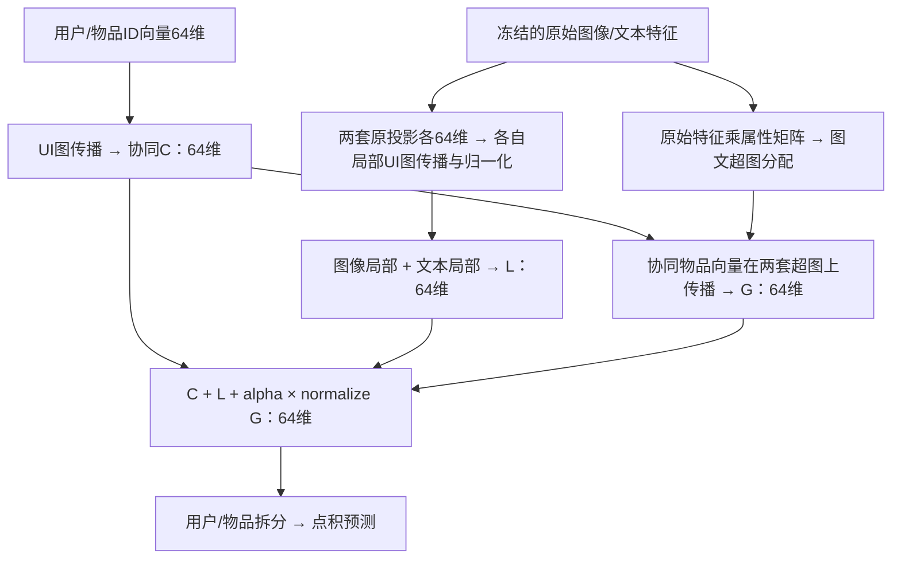
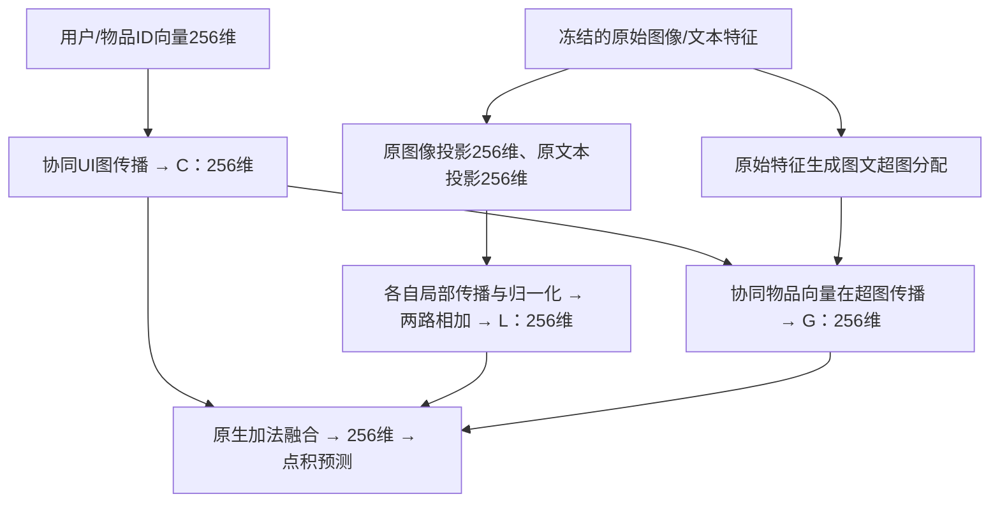
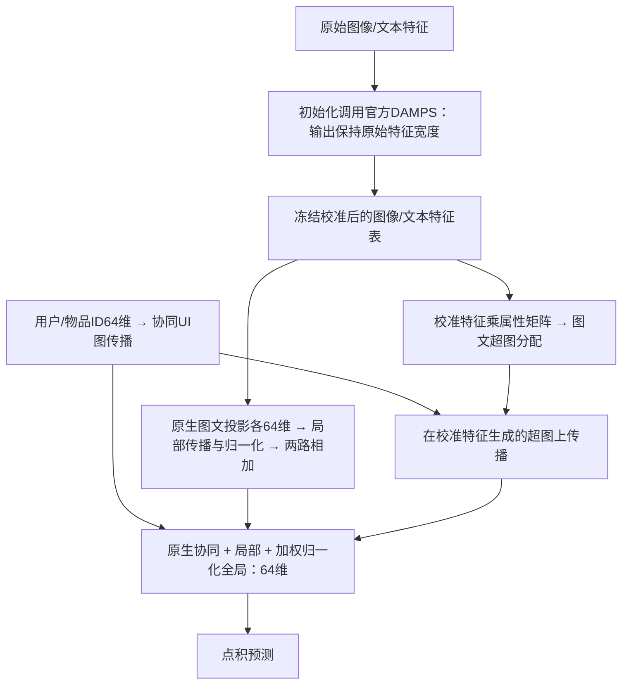
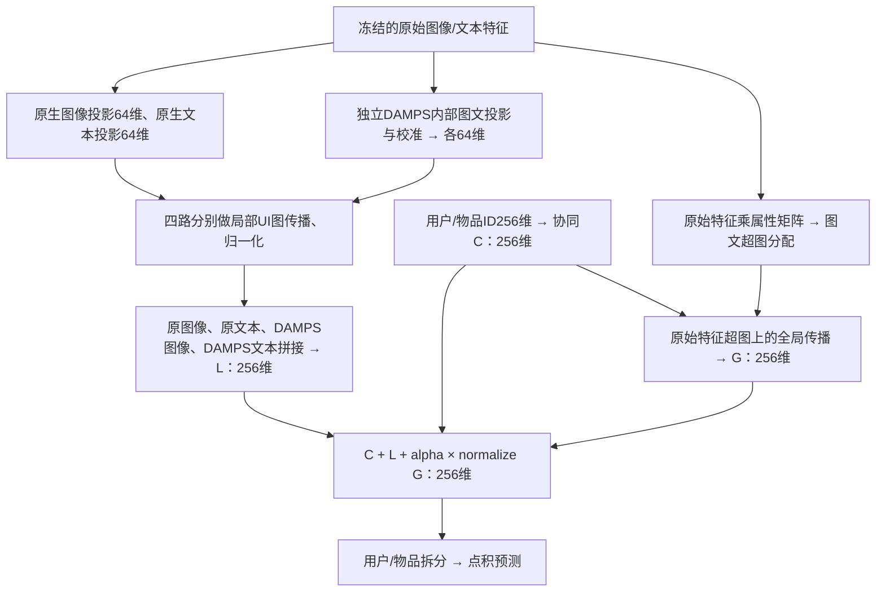

# LGMRec 与 LGMRec+DAMPS 五数据集三种子结果

实验批次：`five-dataset-concat-20261031T103528Z`。原始基线与四路拼接固定种子999、2024、2025的 **30/30** 组已完成；加宽及官方接入补充结果见下表。
五种子实验继续运行；额外种子及五种子汇总仅保留在本地 runs，不纳入本目录或本次提交。

## 四种设计与融合流程

本节说明四种设计；下方成绩表覆盖四种方法和五个数据集，逐行标明完成数及状态，未完成或未安排不填成绩。
`I` 为物品数、`U` 为用户数；图中维度均为单个用户或物品的向量宽度。
“原投影”指骨干原有的图像/文本投影；“DAMPS内部投影”是另一套参数。

| 设计 | 每个局部投影输出 | 局部融合 | 协同/全局宽度 | 最终宽度 |
|---|---:|---|---:|---:|
| 原始 LGMRec | 64 | 图像 + 文本 | 64 | 64 |
| 加宽 LGMRec | 256 | 图像 + 文本 | 256 | 256 |
| 官方 LGMRec+DAMPS 接入 | 64 | 初始化校准后沿用原生加法 | 64 | 64 |
| 四路拼接 LGMRec+DAMPS | 四路各64 | 四路拼接 | 256 | 256 |

统一记协同分支为 `C`、局部分支为 `L`、图文全局超图输出之和为 `G`；最终融合为 `C + L + alpha × normalize(G)`，随后按用户、物品拆分并点积预测。

### 1. 原始 LGMRec：局部图文相加，再与协同/全局相加

局部分支先把物品模态向量聚合到用户，再在UI图上传播；协同分支对包含第0层的各层取均值。图文全局超图的用户、物品输出分别相加。

### 2. 加宽 LGMRec：原有分支统一变为256维

配置为 `embedding_dim=256, damps_enabled=false`。局部图像、文本投影仍各一个；增加输出宽度，不增加投影分支或超边数。

### 3. 官方 LGMRec+DAMPS：仅初始化校准，随后冻结

**训练forward不再调用DAMPS。** 冻结特征表切断了推荐损失到DAMPS的梯度；DAMPS参数虽然注册在模型中，却不被推荐训练更新。可训练的是原生ID、模态投影及超图属性参数。这与官方PGL每次forward调用DAMPS不同，也没有保留原始特征旁路。

### 4. 四路拼接 LGMRec+DAMPS：局部四路拼接，再与协同/全局相加

原始特征始终冻结，但原投影与DAMPS内部投影/校准参数一起训练。全局超图分配继续使用原始特征，不用DAMPS输出。当前入口为 `lgmrec`、`damps_enabled=true`。最终宽度与加宽基线相同，但局部表示的构成和参数量不同。

**官方对照范围：**补充实验保留发布代码的初始化校准、冻结和局部/全局输入路径，使用未改动的官方DAMPS算子；训练/评估仍用COMP5331，初始化在CPU进行，官方相位先验注册为buffer。因此不能称为完整官方框架的逐位复现。

## 四种方法三种子结果（999、2024、2025）

结果更新：**2026-11-02T18:15:10+08:00**（香港时间）。全部固定取seed999、2024、2025，不按成绩挑选种子。
原基线与四路拼接来自原五数据集批次；加宽基线、官方接入来自后续独立对照批次。它们不是同一次训练或同一套融合代码，配置来源见 `four-methods-runs.json`。
数值为已完成种子的测试集均值 ± 样本标准差（n−1）；**仅3/3为完整三种子结果**。部分结果随完成自动更新，未完成不补零。Electronics、MicroLens未安排加宽/官方接入实验，不新增训练。

| 数据集 | 方法 | 完成数 | 状态 | R@10 | R@20 | NDCG@10 | NDCG@20 |
|---|---|---:|---|---:|---:|---:|---:|
| Baby | 原始基线 | 3/3 | 完成 | 0.064557 ± 0.000496 | 0.099403 ± 0.002259 | 0.035095 ± 0.000292 | 0.044050 ± 0.000886 |
| Baby | 加宽基线256维 | 3/3 | 完成 | 0.066799 ± 0.000255 | 0.100655 ± 0.000530 | 0.036062 ± 0.000222 | 0.044760 ± 0.000125 |
| Baby | 官方DAMPS接入 | 3/3 | 完成 | 0.053970 ± 0.001380 | 0.083373 ± 0.001529 | 0.029213 ± 0.000875 | 0.036773 ± 0.000833 |
| Baby | 四路拼接DAMPS | 3/3 | 完成 | 0.060982 ± 0.000980 | 0.094380 ± 0.002442 | 0.033624 ± 0.000244 | 0.042205 ± 0.000616 |
| Sports | 原始基线 | 3/3 | 完成 | 0.071823 ± 0.001335 | 0.106295 ± 0.001308 | 0.038821 ± 0.000460 | 0.047726 ± 0.000539 |
| Sports | 加宽基线256维 | 3/3 | 完成 | 0.074262 ± 0.000091 | 0.109390 ± 0.000315 | 0.040840 ± 0.000220 | 0.049933 ± 0.000222 |
| Sports | 官方DAMPS接入 | 3/3 | 完成 | 0.058298 ± 0.001056 | 0.089143 ± 0.001560 | 0.031788 ± 0.000702 | 0.039730 ± 0.000789 |
| Sports | 四路拼接DAMPS | 3/3 | 完成 | 0.071906 ± 0.001102 | 0.106442 ± 0.000789 | 0.039242 ± 0.000617 | 0.048153 ± 0.000549 |
| Clothing | 原始基线 | 3/3 | 完成 | 0.054901 ± 0.000570 | 0.081195 ± 0.000614 | 0.029740 ± 0.000404 | 0.036415 ± 0.000375 |
| Clothing | 加宽基线256维 | 3/3 | 完成 | 0.059031 ± 0.000433 | 0.086708 ± 0.000729 | 0.032296 ± 0.000199 | 0.039322 ± 0.000183 |
| Clothing | 官方DAMPS接入 | 3/3 | 完成 | 0.042364 ± 0.000389 | 0.064508 ± 0.000080 | 0.022611 ± 0.000233 | 0.028255 ± 0.000115 |
| Clothing | 四路拼接DAMPS | 3/3 | 完成 | 0.057693 ± 0.000784 | 0.085161 ± 0.000137 | 0.031618 ± 0.000327 | 0.038586 ± 0.000118 |
| Electronics | 原始基线 | 3/3 | 完成 | 0.040995 ± 0.000167 | 0.061283 ± 0.000310 | 0.022776 ± 0.000070 | 0.028017 ± 0.000114 |
| Electronics | 加宽基线256维 | 0/3 | 未安排 | 未安排 | 未安排 | 未安排 | 未安排 |
| Electronics | 官方DAMPS接入 | 0/3 | 未安排 | 未安排 | 未安排 | 未安排 | 未安排 |
| Electronics | 四路拼接DAMPS | 3/3 | 完成 | 0.042780 ± 0.000151 | 0.063472 ± 0.000763 | 0.023871 ± 0.000033 | 0.029215 ± 0.000176 |
| MicroLens | 原始基线 | 3/3 | 完成 | 0.071464 ± 0.001557 | 0.109189 ± 0.000739 | 0.037021 ± 0.000850 | 0.046732 ± 0.000642 |
| MicroLens | 加宽基线256维 | 0/3 | 未安排 | 未安排 | 未安排 | 未安排 | 未安排 |
| MicroLens | 官方DAMPS接入 | 0/3 | 未安排 | 未安排 | 未安排 | 未安排 | 未安排 |
| MicroLens | 四路拼接DAMPS | 3/3 | 完成 | 0.078472 ± 0.000431 | 0.115443 ± 0.000740 | 0.041418 ± 0.000505 | 0.050955 ± 0.000565 |

### 相对原基线的变化（仅完整三种子计算）

下面为测试R@20均值相对变化，其他指标均值见上表；不代表统计显著性。

| 数据集 | 加宽基线256维 | 官方DAMPS接入 | 四路拼接DAMPS |
|---|---:|---:|---:|
| Baby | +1.26% | -16.13% | -5.05% |
| Sports | +2.91% | -16.14% | +0.14% |
| Clothing | +6.79% | -20.55% | +4.88% |
| Electronics | 未安排 | 未安排 | +3.57% |
| MicroLens | 未安排 | 未安排 | +5.73% |

四种方法的逐种子结果及有效配置：[four-methods-runs.json](four-methods-runs.json)；完整汇总：[four-methods-summary.csv](four-methods-summary.csv)、[four-methods-summary.json](four-methods-summary.json)。
原有 `runs.json`、`summary.*` 和 `damps-gains.csv` 保留原基线/四路拼接的30组固定三种子记录。所有输出文件均不包含seed2026、2027的成绩。

## 实现与训练协议

- 本目录仅报告固定三个种子 999、2024、2025；原基线与四路拼接30组已完成，补充对照完成情况见上表。五种子实验继续执行，完整结果仅保留本地 runs，不随本目录提交。
- 使用现有数据划分和图文特征；不使用 MicroLens 视频特征。数据内容指纹及划分统计见 `data-fingerprints.json`。
- 各方法固定配置，无逐数据集超参数搜索；加宽基线显式改变embedding_dim，官方适配路径与主方式分开记录。最多1000轮，每轮验证；验证R@20连续20轮无提升早停，选验证最佳checkpoint后评估测试集。
- 全物品排名、过滤训练历史、按用户宏平均、同分按物品ID升序；具体配置和评估协议见 `runs.json`。
- 主方式的DAMPS实现未修改。四路为原图像、原文本、DAMPS图像、DAMPS文本，各64维。
- LGMRec四路局部传播、分别归一化后拼接256维；协同ID和全局超图传播宽度扩展到256维，最后保持加法融合。原始特征冻结，超图分配由原始特征生成；基线最终64维。评估仍按骨干实现采样Gumbel超图。
- 拼接增加维度与参数量，因此不能把结果变化单独归因于DAMPS校准，也不将本结果称为论文原始接入方式的严格复现。
- 训练时模型名为 `lgmrec` / `lgmrec_damps_concat`，使用冻结源码快照。当前代码已合并为 `lgmrec`，通过 `damps_enabled` 切换；布局整理未改变既有实验结果。

## 结果文件

| 文件 | 内容 |
|---|---|
| [four-methods-runs.json](four-methods-runs.json) | 四种方法、五数据集、固定三个种子的逐次结果/配置及未安排占位 |
| [four-methods-summary.csv](four-methods-summary.csv)、[four-methods-summary.json](four-methods-summary.json) | 四种方法的完成数、均值、样本标准差和状态 |
| [runs.json](runs.json) | 全部30个三种子组合、状态、每种子最佳轮次/验证指标/测试指标和实际配置；不含机器路径 |
| [summary.json](summary.json)、[summary.csv](summary.csv) | 分数据集、方法和指标的均值/样本标准差/完成数 |
| [damps-gains.csv](damps-gains.csv) | 四项指标的绝对与相对变化；未完成不计算 |
| [training-protocol.json](training-protocol.json) | 固定种子、训练选择规则、维度与融合说明 |
| [data-fingerprints.json](data-fingerprints.json) | 加载后数据指纹、用户物品数量、三种划分统计 |
| [export-provenance.json](export-provenance.json) | 原批次、导出时间、来源摘要和训练源码哈希 |

不提交原始数据、checkpoint、逐轮日志、缓存或依赖环境。原始产物保留在本地对应 runs 批次。
